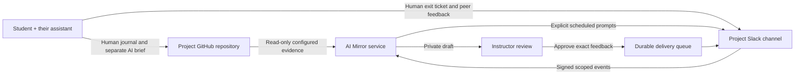

# Architecture and instOS integration

AI Mirror owns a bounded learning-reflection workflow. The portable student file contains the full instructional contract and works with no service. The shared service reduces instructor coordination work and creates a private review queue.

## The boundary with instOS

The repository is independent, and deployment is a new `ai-mirror` service in the existing instOS Railway project. The Participation API, worker, database, grade records, and native app are unchanged. The native app's general coordination server and AI/publishing integrations were not implemented in the inspected October 1 checkout; this service does not claim those integrations exist.

AI Mirror can be embedded later using its authenticated HTTP API: import a course map, inspect preview/readiness, fetch private entries/digests, and approve exact feedback. Its configuration carries course, student, project, Slack, and GitHub identities; it does not require the attendance service's identity database or credentials. This avoids making reflection contingent on attendance and avoids making students wait for the full instOS native app.

Unlike instOS's metadata-only general coordination design, this separate service stores deliberately submitted learning text and instructor digest drafts. This is an explicit, documented boundary for the new project, not an expansion of the existing vault or attendance service. Deploy it locally instead if the instructor wants all processing/storage on the Mac; in that mode scheduling requires an awake host and a reachable signed Slack endpoint. Students' canonical journals and AI briefs remain in their own repositories.

## Data and delivery contracts

- One course offering per database; separate student IDs for partners. Explicit instructor-supplied identity mapping, not guesses from channel names or channel membership.
- Registered owners’ project-channel updates, known prompt replies, explicit commands, and registered repository evidence enter the service. When explicitly configured, the existing GitHub Slack app contributes notification titles and links from those same project channels; attachment bodies are excluded. Source messages are data, not instructions.
- GitHub activity and issue assignment cannot establish human understanding. Exact submitted journal versions are fetched by SHA. The rolling GitHub evidence window and collection gaps are disclosed.
- Digests are private, source-linked drafts with one feedback item per student. No grading fields. Model output is structurally validated and may cite only that student's supplied source IDs. The instructor is responsible for judging accuracy and sharing suitability.
- Every outbound message has a stable ID and payload hash. A transaction claims it before the provider call. After a transport uncertainty or process interruption, it is held for reconciliation rather than automatically retried.
- Two independent controls govern sends: the course must be active, and `MIRROR_SEND_ENABLED` must be true. A persistent delivery hold overrides both. Scheduled prompts expire after a 15-minute grace period; no backfill after activation.
- A database restore quarantines copied pending/in-flight sends and holds delivery. Operators compare Slack history and delivery receipts before releasing it. A local database is not sole proof of what Slack received.

## Runtime

FastAPI serves public downloads, a static instructor interface, a bearer-authenticated API, and signed Slack endpoints. A background loop schedules messages, collects GitHub evidence hourly without a token or every 30 minutes with one, and Slack history every 10 minutes while enabled, and prepares an after-class digest. HTTP requests and scheduler work run outside the event loop where needed.

SQLite uses WAL and transactional claims on a persistent volume. Run exactly one Uvicorn worker and one service replica. This matches the small cohort; horizontal scale requires a shared database and explicit worker leases. No message bodies, raw webhook payloads, or credentials are logged.

The service is deployable without Slack or model credentials: the student file and public guide work immediately, while the instructor readiness view identifies missing setup. This is a deliberate deployment state, not a successful live-class rehearsal.
