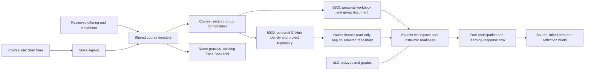

# One setup flow for ENTR students

Status: proposed roadmap, October 23, 2026. The current release adds the 5000 GitHub connection check; the semester-wide setup flow below is a future goal, not a claim that every integration is finished.

## Goal

A student opens one “Start here” link on the course site, signs in with the existing course Slack account, confirms the correct course and group, and completes only that course's remaining steps. John reviews one readiness view. Neither person re-enters names, photos, rosters, or the same learning response in multiple tools.

5500 requires no GitHub account. 5000 repository owners install the course app once per project; each member's GitHub identity is separate. Students never configure Railway, run instOS, or share access tokens.

## Keep each tool's job clear

| Tool | Student view | John's view and source ownership |
| --- | --- | --- |
| Course site | Current instructions, deadlines, course links | Publish reviewed requirements once; workspaces consume the published feed |
| Slack | Existing sign-in, class and team discussion, one participation/reflection response | Exact workspace IDs connect identities and source posts; no parallel student inbox |
| Participation bot | Reuse the current check-in; prep is posted once in the project channel | Attendance and correction records stay in the participation service; learning bridge reads prep and reflections |
| Workspace / AI Mirror | Project overview, own learning evidence, source links | Read course records and evidence; distinguish unavailable access from missing work; review before sending |
| GitHub, 5000 only | Product evidence, individual journal, closed submission issue | Read-only app tokens restricted to one configured repository at a time; human assessment |
| Google documents, 5500 only | One personal workbook and one group project document | Verify instructor access; group progress is an index to the source, not a second submission |
| Face Book name practice | Existing name-practice tool | Plan a directory/photo adapter; do not claim the adapter or account provisioning is implemented |
| eLC | Quizzes and official grades | Reviewed exports and grade entry; no automatic grade inference from evidence |
| Local instOS transcription | Reviewed notes published on the course site | Recordings, transcripts, private notes, and transcription stay local; no student installation |
| Railway | No setup or separate account | Hosting, service secrets, workers, database and backups are instructor infrastructure |
| ChatGPT / Claude | Existing assistant where the assignment allows it | Optional assistant, with assignment-specific authorship rules; no whole-chat capture or second paid account requirement |
| Future AI course bot | One entry to existing course information, if useful | Read the same reviewed sources and grants; do not create another roster, deadline store, or response channel |

## This semester: connect the existing records

Implemented in the GitHub setup release:

- A course-owned public GitHub App requests read-only Contents and Issues; GitHub supplies read-only Metadata. The app cannot write to repositories. Owners choose repositories; public app registration does not grant access to any student repository.
- A private setup view uses existing Slack sign-in. An instructor can inspect all 19 registered projects; students see only their project and team account mappings.
- Connection checks use an actual installation token and repository read. A saved URL or a successful public read is not presented as an app installation. Issues must be enabled for journal receipts.
- Signed, deduplicated GitHub events queue checks only for configured course repositories; periodic reads remain a fallback. Raw webhook content and credentials are not saved as learning records.
- Missing or incorrect usernames and repository links go through John's existing project Slack conversation and explicit reviewed course mapping. This release does not let a typed username establish account ownership or silently rewrite a historical identity.

App registration and each owner's installation still require completion and live verification. The setup view reports those states rather than treating published instructions as proof of access.

## Next: a guided Start here flow

### Shared steps

1. Create the offering from a reviewed template: course, semester, sections, meeting times, approved requirements, source links, and instructor grants.
2. Import the authoritative enrollment snapshot once. Match exact university/source IDs and Slack IDs; route ambiguity to John rather than guessing from names.
3. Sign in with Slack, display the matched course and section, and confirm the group. Students report mistakes without changing their own enrollment or access grants.
4. Reuse the Slack name and photo for course tools. Confirm the existing name-practice app's supported import interface before implementing an adapter.
5. Show only unresolved steps. “Done” requires proof of access or an explicitly labeled instructor confirmation, not merely a stored URL.

### 5500

- Resolve one personal workbook and the group's shared final-project document.
- Verify John can open each required document. Prefer a scoped provider integration if available; otherwise retain a clearly labeled manual instructor check.
- Show entrepreneur, interview, and project milestones from the existing final-project tracker and published guide. Keep the source document authoritative.
- Reuse the current participation check-in and prep posts. Do not add a second attendance action, reflection form, or file upload.

### 5000

- Add verified GitHub user authorization to link each person's immutable GitHub user ID to the already authenticated Slack identity. The current semester's manually reviewed username mapping remains supported during migration.
- Link one repository to the project, using GitHub's immutable repository ID to handle renames and transfers. Show mismatches for review before moving evidence.
- The repository owner installs the read-only app on that repository. Organization approval is a distinct pending state. Partners complete their own identity step, without a second app installation.
- Check read access, Issues availability, the individual journal path, and source links. Preserve the published Build Journal assignment and human authorship rules.
- Store identity or repository mapping revisions with an instructor actor, previous mapping, reason, expected revision, and preserved historical evidence. Do not bypass existing course-map invariants.

## Prep and reflection loop

The current 5500 bridge gathers existing prep posts two hours before each section: 9:35 a.m. and 12:55 p.m. Eastern. This is the instructor prep cutoff; the published student deadline remains before class. Incomplete reads must not become “no response.”

The participation check-in already includes optional takeaway, muddiest point, and next-question fields. Reuse that record for personal and instructor syntheses. Keep private muddy points private; John reviews any class recap. An external model provider, data disclosure, new required fields, or class-wide prompt schedule is a separate decision.

For future offerings, configure each section's meeting time once and derive cutoffs and end-of-class moments in the offering's timezone. Do not maintain a second hand-entered calendar.

## Instructor readiness

One view should distinguish:

- enrollment confirmed; identity unresolved; group unassigned;
- document link present versus instructor access checked;
- GitHub identity instructor-confirmed versus provider-authorized;
- repository missing, owner action needed, organization approval pending, app read verified, Issues disabled;
- access revoked or provider unavailable, with the last successful read and its date;
- prep/check-in coverage with the source's completeness and capture time.

Repair actions should take John or the student directly to the relevant existing service. Show account and project details only within course grants. Attendance eligibility windows must not double as sign-in expiry rules.

## Rollover and exceptions

- Build the next offering as a draft, import reviewed enrollment and groups, test access, then publish its Start here link. Retain semester-specific URLs and archived source history.
- Dual enrollment uses one Slack identity with separate course/section grants and course-specific requirements.
- Late adds receive only future prompts once their identity is confirmed. Withdrawals revoke active grants and cancel future reminders while preserving assessed and historical records. Never infer an earlier withdrawal date.
- Repository rename, transfer, app suspension/removal, document access removal, and organization approval should produce explicit repair states. No silent remapping and no broad personal-token fallback.
- Keep Slack sign-in working. UGA SSO is a possible institutional integration subject to university registration and policy; do not build another password system.

## Delivery phases and acceptance

1. **Current semester — GitHub app and guide.** Register the real app, verify a selected repository read, publish owner/member steps, and track all 19 project states. Remaining owner actions are explicit. Keep class-wide Mirror messaging off.
2. **Shared setup foundation.** Add a reviewed offering template, one enrollment import, immutable identity/source references, and a readiness view. Choose and verify document and Face Book interfaces before claiming integration.
3. **Guided onboarding.** Add verified personal GitHub authorization and source-backed document checks; expose course-specific steps in one Start here view. Trial with real student roles before the next offering.
4. **Semester rollover.** Test creation, updates, withdrawal, archive, and access revocation without copying private historical records into public content.

Acceptance journeys: 5500 morning and afternoon students; 5000 solo and shared projects; dual enrollment; late add; withdrawal; missing or wrong Slack match; organization-owned repository awaiting approval; private repository; Issues disabled; renamed/transferred repository; revoked installation; inaccessible document; provider outage. Each must preserve role isolation and avoid duplicate prompts or submissions.

Success targets are goals to measure in the pilot: one starting URL, one shared sign-in, no repeated name/photo entry, no duplicate learning response, no student infrastructure setup, and one actionable instructor readiness view. Record completion time and unresolved exceptions before setting a numerical onboarding-time target.
