# One course entry, source-owned work

Current direction: October 27, 2026. Project activity comes through Slack. The custom GitHub reader-app plan is retired; students do not install ENTR Project Reader or connect a personal GitHub identity to use the activity dashboard.

## Student path

Students start at the course site, sign in with their existing course Slack account, and see their enrolled classes and project/group. Roster grants determine access. One post or participation response is reused wherever appropriate; students should not submit the same response twice.

5500 students use their group project document and Slack channel. They need no GitHub account. Their cards open a newest-first history of entrepreneur/interview milestones, deliverables, next steps, and source-backed updates.

5000 students use their existing project Slack channel for progress, including threaded replies. GitHub's official Slack integration shares repository notifications into that channel. The course collector reads titles and links there, without direct repository access. Owners retain responsibility for authorizing their repository's Slack integration; no notification does not establish inactivity. Individual journals, exact-version links, and submission issues still follow the Build Journal assignment.

```mermaid
flowchart TD
  Start[Course site: Start here] --> Slack[Existing Slack sign-in]
  Slack --> Roster[Enrollment and project grants]
  Roster --> Intro[5500: group document and interview milestones]
  Roster --> AI[5000: project channel and repository notifications]
  GitHub[GitHub official Slack integration] --> AI
  Intro --> Cards[Project cards and source-linked timelines]
  AI --> Cards
  Prep[Participation bot: one prep response / check-in] --> Brief[Student synthesis and instructor prep]
```

## Tool responsibilities

| Tool | Student work | Instructor use |
| --- | --- | --- |
| Course site | Instructions, schedules, assignment guides, one entry point | Canonical course record and signed-in overview |
| Slack | Project conversation and progress posts | Source-linked project activity and communication |
| Participation bot | One prep response, attendance/check-in workflow | Prep cutoff, coverage, and synthesis; human review |
| GitHub, 5000 only | Product evidence, individual journal, submission issue | Notification titles via Slack; open source links for deeper review |
| Shared documents, 5500 | Interview, themes, final project process | Source-owned progress and document access |
| eLC | Quizzes and grades | Official grade record |
| Name practice | Existing Face Book tool | Reuse roster names/photos; no second identity |
| Local recordings | No extra student setup | Private transcription and reviewed course summaries |
| Railway | No student setup | Hosting for the existing services |
| ChatGPT / Claude | Optional assistance under assignment policy | Drafting and analysis with human judgment |
| AI Mirror | Shared project activity and portable journal workflow | Review, sources, prompts only when explicitly enabled |
| Future course bot | Ask questions against reviewed course sources | Reuse the same identity and sources; no parallel submission system |

## Implemented now

- Shared Slack session and explicit course/section grants; withdrawn enrollment loses access.
- 5500 milestone records with own-group edits, instructor verification, and revision history.
- 5000 cards and timelines combine shared project-room posts/replies, official GitHub notification titles, and project pins. Private pins, muddy points, journals, and digests stay out of the class view.
- Slack recovery reads disclose failures and limits. A quiet channel, missing repository mapping, and a failed read are distinct states.
- The same participation responses feed preparation and check-in views. The 5500 instructor prep cutoff is two hours before each class; the published student deadline remains before class.
- A project owner checks GitHub-to-Slack subscriptions in the existing channel. The feed needs no personal GitHub username mapping or custom reader installation.

## Next offering: guided onboarding

Provide one **Start here** view with the student's class, group, expected tools, and only the steps relevant to that course.

1. Confirm Slack identity and enrollment; handle late adds, withdrawals, dual enrollment, and unmatched groups explicitly.
2. Confirm 5500 document/workbook links and instructor access, without duplicating the documents.
3. Confirm 5000 project channel and repository link. Check existing GitHub-to-Slack notification setup and keep source links available. Use one subscription per project, not per partner.
4. Reuse Slack photos and the existing name-practice roster.
5. Rehearse participation/prep/check-in once with a real student role. Keep class-wide messages off until the instructor chooses the delivery schedule.
6. Show only actionable setup failures. Silence in a feed is not a student performance judgment.

Before a semester rollover, create a draft offering, import reviewed enrollment and groups, verify access, then publish its Start here link. Preserve semester-specific URLs and archived source history. Students never configure Railway or share access tokens.

## Retired implementation

ENTR Project Reader was registered and tested on a private synthetic repository on October 23. On October 27 John chose Slack instead. The current course does not use its credentials, installation checks, webhooks, or direct repository collector. Legacy direct mode remains in the source for compatibility; it is not the onboarding plan. Historical evidence remains archived rather than being represented as a current Slack read.
